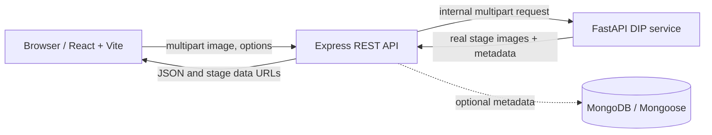

# ReviveAI — Classical Photo Restoration

ReviveAI is a local photo restoration monorepo for demonstrating classical digital image processing. The React client talks only to Express; Express calls the local FastAPI service, which processes the uploaded image with OpenCV and NumPy. No cloud or paid API is used.

## Architecture



## Features

- Upload JPG, PNG, WEBP through Express with file limits and MIME/decoded-image checks.
- Quick Restore, Scratch Repair, Full Restoration, and Custom modes.
- Gaussian, median, and bilateral denoising; LAB/CLAHE contrast; morphological scratch mask; Telea or Navier–Stokes inpainting; unsharp masking.
- Optional local Real-ESRGAN x2 detail enhancement runs inside the Python service after DIP scratch repair. It uses the bundled NCNN/Vulkan runtime and model, blends with a Lanczos enlargement to retain the source composition, and falls back to the classical result if the model cannot run.
- Bundled runtime/model source: [Real-ESRGAN NCNN Vulkan](https://github.com/xinntao/Real-ESRGAN-ncnn-vulkan), distributed under its upstream license.
- Actual generated intermediate stages, original/restored comparison, download, metrics panel, and optional reference-image evaluation.
- Optional MongoDB restoration history; restoration remains available when MongoDB is not configured.
- No reference means PSNR, SSIM, and MSE are reported as unavailable, never fabricated.

## Requirements

- Windows 10/11, Node.js 20+, Python 3.11 or 3.12, and MongoDB Community (optional).
- OpenCV, NumPy, Pillow, scikit-image and FastAPI are installed in the Python virtual environment.

## Run locally (Windows PowerShell)

From the `ReviveAI` folder, use three terminals. If using MongoDB locally, start its service first (for example `Start-Service MongoDB` in an elevated terminal), or set `MONGODB_URI` in `server/.env`.

**1. Python DIP service**

```powershell
cd dip-service
py -3.11 -m venv .venv
.\.venv\Scripts\Activate.ps1
python -m pip install -r requirements.txt
python -m uvicorn app:app --host 127.0.0.1 --port 8000
```

**2. Express API**

```powershell
cd server
npm install
Copy-Item .env.example .env
npm run dev
```

**3. React client**

```powershell
cd client
npm install
npm run dev
```

Open the Vite URL, normally `http://localhost:5173`. The API listens on 5000 and the private DIP service on 8000. The client never calls the Python service directly.

## API

- `GET /api/health` — Express and DIP service status.
- `POST /api/restoration/restore` — multipart `image`, plus JSON string field `options`; returns original, restored, executed stages, duration, and metadata.
- `POST /api/restoration/evaluate` — multipart `reference` and `restored`; returns MSE, PSNR, SSIM only for compatible decoded images.
- `GET /api/restoration/history` — recent metadata when MongoDB is connected; empty list otherwise.

## Algorithms

- Gaussian convolution smooths high-frequency noise but can soften edges. Median filtering replaces each pixel with its neighborhood median and is useful for impulse noise. Bilateral filtering weights spatial proximity and color similarity to retain edges.
- CLAHE applies local histogram equalization to the LAB lightness channel, preserving chroma: \(L' = \operatorname{CLAHE}(L; c, g)\).
- Scratch candidates combine morphological top-hat and black-hat responses, thresholding, and line-like contour filtering. They are heuristic and can flag texture or features.
- Inpainting estimates masked pixels from nearby unmasked pixels (Telea fast marching or Navier–Stokes diffusion); it works best for thin scratches, not large missing regions.
- Unsharp masking: \(I_{out}=\operatorname{clip}(I + \alpha(I-G_\sigma*I),0,255)\).
- Reference metrics: \(MSE=\operatorname{mean}((R-I)^2)\), \(PSNR=10\log_{10}(MAX^2/MSE)\), and scikit-image SSIM. Inputs are resized to a common size for evaluation; this assumes the images are aligned.

## Folder structure

`client/` React + Vite + Tailwind + Router + Axios + Lucide. `server/` Express, Multer, validation, Python bridge, optional Mongoose model. `dip-service/` FastAPI and reusable OpenCV/evaluation modules.

## Limitations and future work

Classical methods do not understand image content and can over-inpaint real lines or facial details. Large tears and missing content cannot be reconstructed reliably. This first version offers automatic mask detection but no manual mask painting, and history is optional metadata persistence only. Future work could add manual mask editing, reproducible synthetic-degradation experiments, and richer history browsing.

## Tests

Python tests use synthetic images: `cd dip-service; python -m unittest`. API boundary smoke checks: `cd server; npm test`. The client provides build validation with `npm run build`. Do not interpret metric values as improvement without an aligned clean reference.
